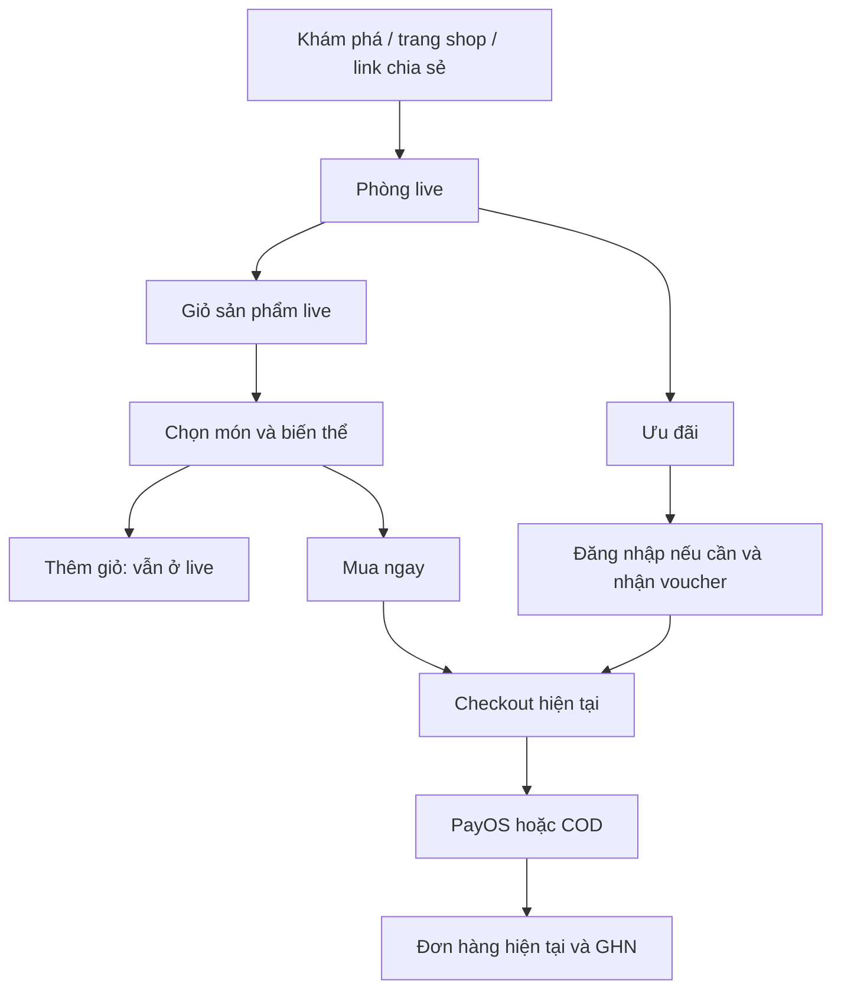

# PLAN-0015 — Thiết kế giao diện khách FITLY Live

> Status: Design finalized — kế hoạch đã chốt, chưa code · 2026-11-06
> Bản tổng: [Backend PLAN-0045](../../../eco_backend/docs/plans/PLAN-0045-livestream-commerce-design.md).
> Đồng bộ cổng shop/sàn: admin PLAN-0008-livestream-ui-design.md.
> Rà soát lần2: [biên bản mua hàng/lỗi](../../../eco_backend/docs/plans/PLAN-0045-livestream-review-2026-11-06.md); 18 phát hiện và bộ LIVE-17–36, chưa triển khai.
> Theo uỷ quyền mới: [quyết định FITLY cuối](../../../eco_backend/docs/plans/PLAN-0045-livestream-final-decisions.md) chốt A+B và policy FITLY_LIVE_V1; không còn yêu cầu match Shopee1:1.

## 1. Mục tiêu

Xây trải nghiệm FITLY Live có mua hàng E2E, phù hợp nhận diện FITLY và quy tắc sàn hiện có. Shopee chỉ là tham khảo. Chuẩn nghiệm thu là ma trận L01–L33 cho A+B, LIVE-01–36 và7 ví dụ policy ở quyết định cuối; không cần đối chiếu app Shopee có đăng nhập hoặc pixel-perfect. Chủ dự án giao tự chốt kế hoạch; yêu cầu không viết ứng dụng trong đợt này vẫn giữ.

## 2. Nhận diện và cấu trúc

- Storefront vẫn Vineta SCSS + Bootstrap/offcanvas/modal; không thêm Tailwind/shadcn hoặc UI kit mới.
- Be Vietnam Pro cho giao diện mua/chat, Playfair Display cho tiêu đề khám phá; primary coral #ff6f61 qua token hiện hành, nền trắng, chữ tối. Video có nền tối riêng, không đổi toàn website sang dark theme.
- Điểm nhấn: thẻ hàng ghim có số thứ tự coral dùng nhất quán trong video và danh sách hàng.
- /live là trang khám phá trong shell hiện có. /live/[id] dùng chế độ xem tập trung: trên desktop header rút gọn, trên mobile player chiếm vùng xem; không để chatbot/toolbar/scroll-top che chat/nút mua. Ra khỏi trải nghiệm live khôi phục shell cũ.
- Không nhân đôi CartDrawer/AuthDrawers/ShareModal. Panel mua live có ngữ cảnh riêng, nhưng chỉ một overlay tương tác giữ focus tại một thời điểm.

## 3. Danh sách màn và hành vi

| Màn | Bố cục | Hành vi chính |
|---|---|---|
| U01 Khám phá | Tiêu đề FITLY Live, đang live/sắp phát, lọc ngành/shop, card ảnh bìa | Nhấn card mở phòng; URL giữ filter/trang; ảnh bìa thay autoplay danh sách |
| U02 Phòng live | Shop/Follow/viewer/đóng; video; chat; món ghim; hàng/ưu đãi/tim/share/report | Bật tiếng theo browser; video giữ tỉ lệ; khách xem không xin camera |
| U03 Sản phẩm | Panel có tìm, hàng đánh số, ảnh/tên/giá/tồn | Chọn món sang biến thể, đóng quay về live |
| U04 Biến thể | Ảnh/giá server, trục thật, số lượng, hai nút mua | Thẻ ghim mở trực tiếp U04; Back về nơi mở; Mua ngay tạo intent chỉ dòng chọn |
| U05 Checkout | Màn hiện tại + intent/nguồn live hợp lệ | Dùng chung pricing/order, bổ sung basket độc lập; giá/kho/GHN/voucher do BE |
| U06 Ưu đãi | Điều kiện/thời hạn/trạng thái nhận và dùng | Đăng nhập khi nhận; trạng thái do BE, không tính giá trên FE |
| U07 Báo cáo | Loại+lý do+gửi; kết quả tiếp nhận | Không tự dừng live vì một báo cáo |
| U12 Kho voucher của tôi | /account/vouchers trong promotion | Claim của user, expiry/lý do chưa áp, restore và Mua lại |
| U08–11 Mở rộng | Replay/game/xu/đồng dẫn | Backlog C ngoài demo; ẩn chức năng, không hiện nút giả |

Desktop: video trái + panel chat/sản phẩm/voucher phải. Mobile390px: shop trên, video nền, chat dưới video, thẻ ghim trên thanh thao tác; sản phẩm/voucher mở bottom sheet. Chi tiết wireframe ở bản tổng §5.

## 4. Luồng khách đầy đủ

Khách vãng lai được xem; tương tác cần quyền/đăng nhập thì hiện yêu cầu tại thao tác đó. Đăng nhập xong phục hồi đúng room/panel. Không tự động gửi chat hoặc tự nhận voucher thay khách.

Back đóng panel con trước, trở về panel cha rồi mới rời phòng. Product pin thay đổi không làm mất lựa chọn đang mua. Giỏ hàng shop khác không bị xoá khi Mua ngay. Video chỉ được duy trì trong phạm vi document/layout cho phép; khi rời sang PayOS bên ngoài rồi quay lại phải reconnect, không cam kết phát liên tục xuyên website khác.

### 4.1 Bổ sung sau rà soát

- Thẻ ghim/Mua mở thẳng biến thể món đó, không bắt qua danh sách; giỏ live mới mở U03. Back về đúng điểm vào, không bắt quay qua danh sách nếu không đi từ danh sách. Có Xem chi tiết/đánh giá/shop và Quay lại live, giữ context hợp lệ.
- Giỏ hàng cá nhân và danh sách hàng host gắn là hai đối tượng khác nhau. Hiện tag nguồn live ở giỏ/checkout theo BE. Khi dòng SKU chứa cả lượng thường và lượng live, hiển thị rõ phần đủ điều kiện thay vì tô tag cho cả lượng.
- Không tái dùng trực tiếp hook muaNgay hiện tại: hook thêm vào giỏ rồi mở checkout. Cần intent basket riêng, không bỏ tick hàng khác để giả Mua ngay. Hooks summary hiện phụ thuộc giỏ không rỗng, nên intent summary phải có điều kiện/query key riêng đúng contract, không bị giỏ trống chặn tải.
- Mua ngay không xoá hàng thường cùng SKU hoặc mã đã chọn của giỏ thường sau thành công. Mua từ giỏ chỉ trừ lượng snapshot/lot đã mua; không gọi dọn giỏ/voucher toàn cục một cách làm mất dữ liệu tab khác.
- Checkout giữ attempt tham chiếu thuộc tài khoản qua reload. Timeout/5xx là đang xác minh; Hủy chờ chỉ dừng chờ, không tự huỷ đơn. Không đổi key/payload để thử tạo lần khác khi chưa rõ kết quả.
- Đổi tài khoản/logout dọn pointer/player/context; BE vẫn kiểm owner. Đăng nhập lại giữ ý định mua nhưng quote lại và yêu cầu khách xác nhận, không tự đặt đơn.

### 4.2 Các trạng thái mua phải có trên UI

| Tình huống | Giao diện/hành động |
|---|---|
| Chưa có địa chỉ/mã GHN | Chọn hoặc sửa địa chỉ ngay, giữ món đang mua |
| GHN lỗi/ngoài tuyến | Phí chưa xác định; retry hoặc đổi địa chỉ, không ghi0đ |
| COD không đủ điều kiện | Lý do cụ thể; khách tự chọn method khác rồi quote lại |
| Voucher không áp/hết hạn/thu hồi | Giữ thông tin, chỉ rõ mã và điều kiện; gỡ/đổi mã có xác nhận tổng mới |
| Intent hết hạn | Dựng lại sau kiểm nguồn/kho/giá; không giả giữ kho30 phút |
| Đang xác minh đặt hàng | Khóa tạo lần mới, mở đơn khi xác định được, cho tiếp tục kiểm tra |
| Đã có đơn nhưng link thanh toán lỗi | Chờ/thử tạo link của đúng đơn, không Đặt lại hàng |
| Nhiều đơn con trả một phần | Trạng thái từng shop và nút thanh toán đúng đơn còn chờ |
| Live kết thúc/media lỗi | Banner riêng, không tự huỷ checkout/đơn còn hợp lệ |

Đồng thời tách nhãn Đã nhận mã/Đủ điều kiện dùng/Đang dùng cho đơn/Chờ hoàn tất hoàn tiền/Đã khôi phục/Hết hạn/Đã thu hồi. Policy FITLY_LIVE_V1 đã chốt: chỉ restore sau toàn bộ covered quantities đã huỷ/hoàn và nghĩa vụ tiền hoàn đã xong, còn hạn/chưa thu hồi; hoàn một phần không trả cả mã. “Giá sau ưu đãi” phải là giá BE xác nhận theo điều kiện hiện tại, không hiển thị giá tối ưu giả cho mọi khách.

### 4.3 Kho voucher và mua lại sau restore

- Bổ sung mới /account/vouchers trong promotion, dùng lại VoucherTicket/VoucherList và shell tài khoản hiện có; code hiện tại có danh sách/picker voucher nhưng chưa có kho claim cá nhân. Không tạo kho chỉ sống trong phòng live. Chi tiết đơn có link tới claim tương ứng và trạng thái thực từ BE; khai route/menu bằng constants khi triển khai.
- Đã khôi phục vẫn hiển thị hạn dùng gốc (actualStartedAt+24 giờ), không hứa giữ lượt/stock hoặc kéo dài thời hạn. Khi quota chung hết, hiện lý do chưa áp được dù quyền đã được trả lại.
- “Mua lại với voucher” dựng intent bằng recovery entitlement của server: đúng user/SKU/tối đa quantity gốc, có thể dùng khi live đã hết. Không gắn tag nguồn cho món thường/quantity vượt quyền. Nếu hàng hết, shop khoá hoặc giá/minOrder thay đổi, hiển thị rõ và quote lại; không tự chọn món thay thế.
- Mã không được restore do hoàn một phần/hết hạn/thu hồi có thông điệp tương ứng, không có nút nhận tiền mặt/mã bù. Trạng thái refund do payment, không suy từ việc đơn cancelled.

## 5. Trạng thái bắt buộc

Phòng: loading/connecting/playing/muted/reconnecting/ended/terminated/unavailable. Media/chat/API có trạng thái riêng: video lỗi không làm biến mất giỏ còn dùng được; commerce API lỗi phải khoá mua; socket lỗi tải lại snapshot trước mua. Panel: loading/error/empty/hết hàng/hàng ẩn/giá đổi. Chat: sending/sent/failed/muted/auth-required. Voucher: chưa nhận/đã nhận/hết lượt/hết hạn/thu hồi/đã dùng. Countdown chỉ hiển thị từ serverTime/endAt, không tự quyết hạn.

Mỗi trạng thái có thông điệp và hành động phù hợp; không trả spinner vô hạn hoặc “chưa tìm thấy” khi media thật sự đang lỗi. Đã ended thì không tự hồi sinh khi webhook cũ về. Không bịa số online, like hoặc đơn mẫu thành số thật.

## 6. Ranh giới tích hợp khi được phép code

- Route chỉ render feature livestream, đường dẫn khai trong lib/constants.ts. Feature đặt components/{discovery,viewer,products,vouchers}/, hooks/, api/, schemas/, types/, stores/.
- REST qua Swagger→Orval→feature hook→shared axios. Media SDK/WebSocket là kết nối riêng có auth/lifecycle, không giả chúng là REST fetcher.
- TanStack Query giữ snapshot server; event cập nhật cache với sequence/version. Zustand chỉ giữ client state như panel/mute/phiên player, không copy order/product server state thành nguồn sự thật.
- Player bền qua điều hướng cần thiết kế boundary ở layout chung phù hợp, chỉ mount một media connection. Đổi scope/logout phải dọn session, không giữ quyền cũ.
- VariantPicker/useVariantPicker hiện nằm trong internals catalog. Không import chéo feature trực tiếp; khi triển khai phải trích phần dùng chung thành public/shared boundary có cập nhật caller cũ và kiểm hồi quy. Không viết lại bộ chọn hardcode size/màu.
- Theo dõi shop là tính năng BE mới, không dùng wishlist sản phẩm giả làm follow.
- Giá, tổng, tồn và ưu đãi thuộc BE; dùng Price/formatMoney hiện có. SourceSessionId phải được server kiểm, không làm bằng chứng hưởng voucher.
- Lịch phát/notification dùng module system/shop hiện tại qua API, có chống thông báo lặp; không polling mỗi giây toàn trang.

## 7. Mobile và accessibility

390px không tràn ngang; video giữ aspect; icon44px; safe-area; ô chat thấy khi bàn phím mở. Mở sheet khoá scroll nền và quản lý focus; Esc/Back đóng lớp trên; trả focus về nút mở. Phím Enter gửi/Shift+Enter xuống dòng; disabled có giải thích; aria-live chỉ thông báo trạng thái quan trọng, không đọc mọi tim/chat liên tục. Reduced-motion tắt mưa tim, hiệu ứng; chức năng vẫn dùng được.

## 8. Thứ tự dự kiến và kiểm chứng

- [x] Thiết kế màn và ràng buộc tương thích framework.
- [x] Định nghĩa kết nối/Back/panel/checkout/error và ma trận ở bản tổng.
- [x] Rà soát lần2, bổ sung intent/lot nguồn/unknown result/GHN-payment lỗi/hoàn ưu đãi và cổng LIVE-17–36.
- [x] Theo uỷ quyền chủ dự án, chốt UX FITLY và bỏ cổng match Shopee1:1.
- [x] Chốt demo A+B, default và policy FITLY_LIVE_V1; C là backlog.
- [x] Theo yêu cầu triển khai: discovery/viewer, media LiveKit + Socket.IO lazy, panel sản phẩm/biến thể, cart nguồn theo quantity, buy-now intent riêng, claim/wallet/recovery, follow/report/chat và mini-player.
- [ ] Lint/typecheck/build, browser390/desktop, hai thiết bị phát/xem thật và E2E đơn→GHN.

### Bằng chứng triển khai storefront ngày 06/11/2026

- REST đã đồng bộ Swagger→Orval từ API kiểm chứng local; không dùng response giả để thay media/chat/commerce.
- Lint và typecheck thành công; lint còn hai cảnh báo img có sẵn ở account-shell/profile-screen. Build production chốt thành công, tạo đủ36 trang static và các route dynamic mới. Các trang catalog prerender dùng URL API công khai đã có để tránh phụ thuộc API local4000 trong env của máy; không thay file env.
- Browser Chrome thật: discovery đọc phiên từ BE; đăng nhập thật; viewer decode video LiveKit 320×180, trên 50 frame. Mini-player giữ kết nối khi chuyển client route sang checkout/wallet.
- Cart đã có một đơn vị thường: thao tác Thêm giỏ trong live đưa tổng quantity lên2, eligibleQuantity1 và một sourceLot. Buy-now tạo intent một SKU/quantity1, quote từ server130.000đ; giỏ quantity2 giữ nguyên.
- Nhận voucher trong phòng thành công; wallet hiển thị trạng thái Đã nhận. Áp mã vào intent: server giảm50.000đ, tổng80.000đ; bấm Đặt hàng qua UI tạo nhóm COD và trang thành công đúng80.000đ, giỏ trước đó giữ nguyên. Không giả định claim giữ tồn/lượt dùng.
- Phòng/sheet tại390px không tràn ngang; khoá scroll, focus và Back đóng sheet được kiểm tra. Desktop1440px đã xem ảnh render; sửa xung đột kiểu button/topbar Vineta.
- Khi API tạm dừng trong kiểm tra, quote lỗi có nút thử lại và Đặt hàng bị khoá; không dùng tổng cũ để đặt.
- Media local dùng canvas/audio phát qua LiveKit thật để kiểm chứng truyền/nhận; chưa là kiểm chứng camera phần cứng, hai máy mạng ngoài hay benchmark tải. E2E GHN và thanh toán/hoàn tiền do đợt kiểm chứng BE chung ghi nhận riêng.
- Discovery có tìm kiếm, trạng thái, phân trang và lọc ngành hàng bằng categorySlug trên server trước phân trang. Các lựa chọn ngành lấy từ danh mục lá thật của catalog; đổi ngành đặt lại trang1 và lưu lựa chọn trong URL. Browser390px kiểm chứng chọn ngành lá thật: categorySlug đúng, page1, giữ nguyên q/state, không tràn ngang.

